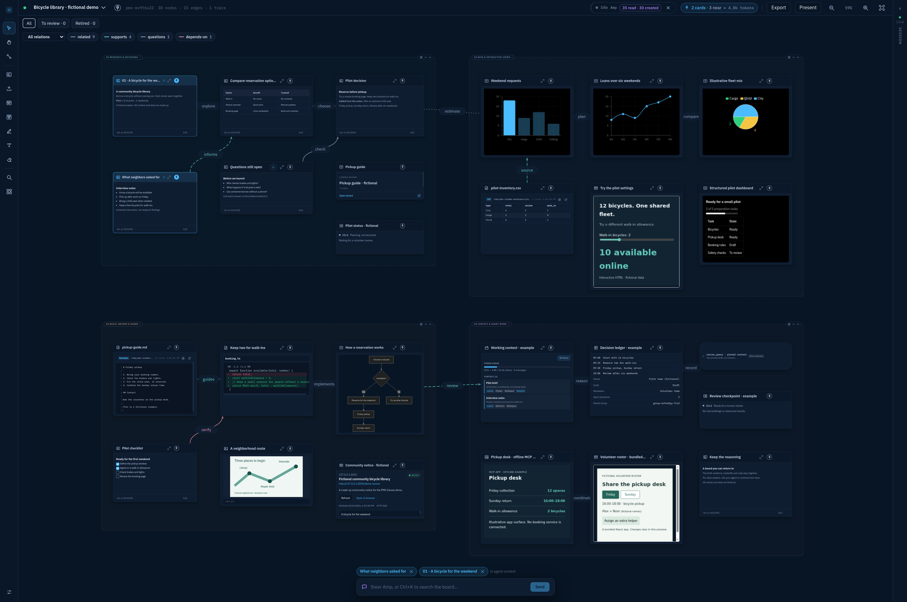
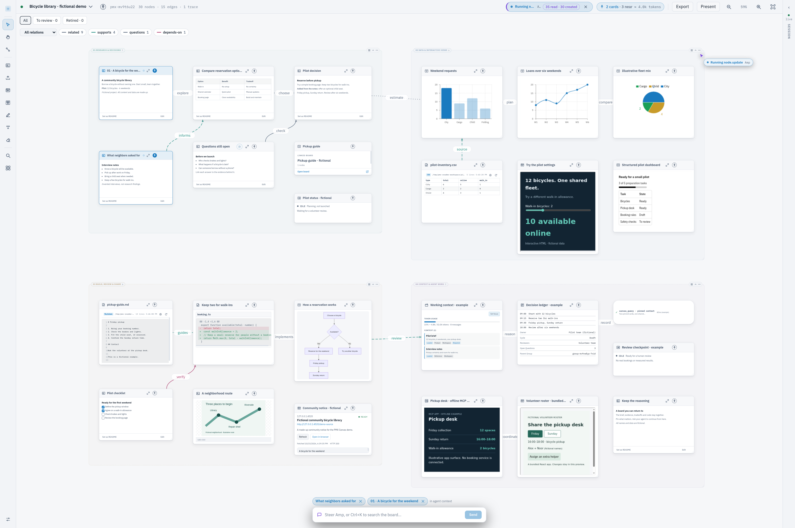

# pmx-canvas

PMX Canvas is a shared visual workspace for you and your AI agents. You both
add and edit material on the same board, in real time. Keep research, files,
charts, diagrams, and interactive views together as you think, plan, and work.

## Your extended memory

When work is spread across chats and files, you keep explaining the same
background and piecing together earlier decisions. The board is your extended
memory and your agent's working memory. Keep what you've learned, connect it
to its sources, and return to it in the next session.

You choose what goes into the agent's context by pinning cards and boards.
See what the agent has read, what has changed since, and what it added or
edited. Boards save locally and link to one another, so you can build a
library of knowledge alongside your ongoing work.



*Harbor, the dark theme.*



*Daylight, the light theme. Both screenshots show the working app with fictional
content and data.*

## A moldable canvas

Put notes, files, web pages, images, charts, code diffs, and diagrams side by
side on an infinite canvas. Ask your agent to build a dashboard, comparison,
or interactive view on the board as you work. You can open a rich view in its
own tab when you need more space.

- **Organize your work.** Move and group cards, draw annotations, and connect
  ideas with labeled links. Use folders, search, and the board map to find
  earlier work.
- **Work with agents.** Ask one or several agents to add material, track
  tasks, and update the board. Review their changes and send instructions
  from the canvas when your agent connection supports it.
- **Keep knowledge useful.** Link conclusions to evidence, set review dates,
  and see which dependent cards need checking when a source changes.
- **Save and share.** Use undo, snapshots, and backups. Present a board as a
  tour or export it as a self-contained HTML file.

## Install and start

### With your agent (recommended)

Install [Node.js](https://nodejs.org/) (LTS), which includes npm and `npx`.
Then install the PMX Canvas skill and choose your agent if prompted:

```bash
npx skills add pskoett/pmx-canvas/skills/pmx-canvas
```

Then ask your agent:

> Use the pmx-canvas skill to install and set up PMX Canvas for this project.
> Start the canvas, check that you can connect to it, and give me the link to open it.

The skill gives your agent instructions for installing PMX Canvas, connecting
to it, and working on boards. It doesn't install the app by itself; your agent
walks you through setup and any permissions it needs. No repository clone is needed.

### Run it yourself

Install [Bun](https://bun.sh) 1.4.2 or newer, then run this command from the
folder where you want to keep your boards:

```bash
bunx pmx-canvas
```

The command starts the canvas and opens it in your browser. To explore a
sample board first, run `bunx pmx-canvas --demo` in an empty folder.

For a permanent installation:

```bash
bun add -g pmx-canvas
pmx-canvas
```

## Connect your agent

PMX Canvas works with Claude Code, Codex, GitHub Copilot, Amp, and other agents
through MCP, the protocol agents use to call tools. If your agent handled setup
above, you're ready to make your first board. Otherwise,
use a plugin or configure MCP directly. You don't need both for the same agent.

### Plugins

The [PMX Canvas plugin](docs/agent-plugin.md) follows the open
[Agent Plugins 1.0 standard](https://agent-plugins.org/). Use it in any client
that supports the standard's MCP stdio connections. Bun must be installed;
a global PMX Canvas installation isn't required.

**In GitHub Copilot**, you can install directly from GitHub:

```bash
copilot plugin install pskoett/pmx-canvas:plugins/pmx-canvas
```

Copilot currently accepts this command, but warns that direct GitHub installs
are deprecated and a future release will require a marketplace. If your version
no longer accepts it, use the MCP setup below.

Enable it, start a new project session, and open **PMX Canvas**. Copilot also
gets a native canvas panel; that panel is not part of the portable standard.

Other apps have their own plugin install commands or UI. See the official
[compatible clients and setup guides](https://agent-plugins.org/compatible-clients)
and the [PMX plugin guide](docs/agent-plugin.md). There is no single install command
for every client.

### MCP setup

Without a plugin, add a server to your agent's MCP settings with command
`bunx` and arguments `pmx-canvas`, `--mcp`. Clients that use an `mcpServers`
configuration accept:

```json
{
  "mcpServers": {
    "canvas": {
      "command": "bunx",
      "args": ["pmx-canvas", "--mcp"]
    }
  }
}
```

Start your agent in the same project folder as the canvas, then enable or
approve the connection in your agent app. The MCP server can also start the
canvas on its first tool call.

Settings differ by app. Follow the [setup guide](skills/pmx-canvas/references/installing-pmx-canvas.md)
for your client, including [Amp and orbs](skills/pmx-canvas/references/installing-pmx-canvas.md#amp-connect-the-agent-separately-from-the-portal).

## Make your first board

Ask your connected agent:

> Create a PMX Canvas board with an overview of the recent projects and
> threads we've been working on together. Group related work, summarize the
> decisions and open questions, and link back to the threads and files you
> can access. Show what's in progress and what we could pick up next. Tell
> me if you're missing context rather than guessing.

Open the board, move related cards together, and pin the ones you want the
agent to use. Then ask it to read the pinned cards and help you continue the work.
You can also add notes and files yourself. Press `?` on the board for keyboard
shortcuts.

Boards auto-save in `.pmx-canvas/canvas.db` inside your project folder.
Use the same folder when you return. Autosave isn't a backup; see the
[backup commands](docs/cli.md#backup-and-restore) to keep a separate copy.

PMX Canvas runs locally and has no built-in multi-user accounts. Connected
agents share the same open board. Content you ask an agent to read goes
through that agent's tools and model provider; web content and hosted apps
also use their external services.

## Documentation and development

- [Setup guide](skills/pmx-canvas/references/installing-pmx-canvas.md) and [plugin guide](docs/agent-plugin.md)
- [Cards and views](docs/node-types.md)
- [CLI](docs/cli.md), [MCP](docs/mcp.md), [HTTP API](docs/http-api.md), and [Bun SDK](docs/sdk.md)
- [Environment settings](docs/environment.md) and [changelog](CHANGELOG.md)

To run from source:

```bash
git clone https://github.com/pskoett/pmx-canvas.git
cd pmx-canvas
bun install
bun run build
bun run dev
```

See [AGENTS.md](AGENTS.md) for contributor guidance. Report bugs or suggest
features in [GitHub issues](https://github.com/pskoett/pmx-canvas/issues), or
use **Bug and feedback** in the canvas toolbar.

[MIT license](LICENSE).
